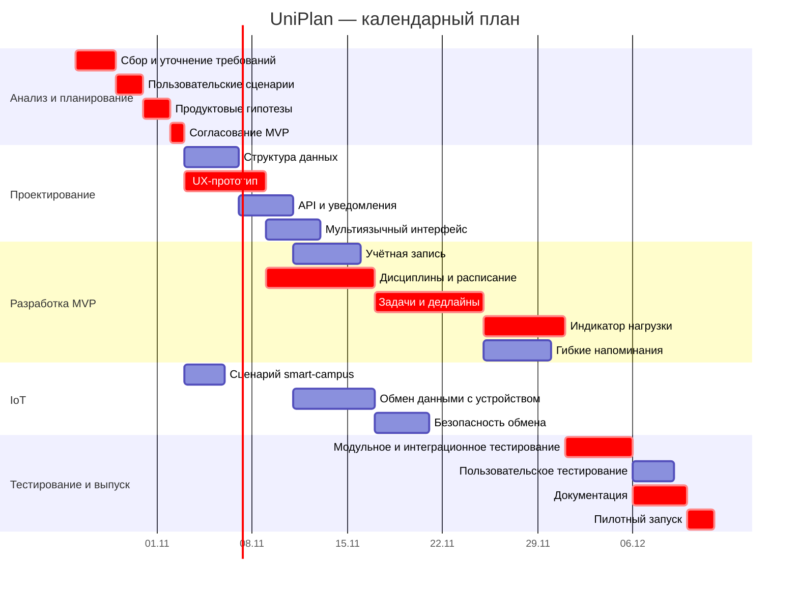

# Лабораторная работа №6 — календарный план UniPlan

Календарный план построен по WBS из ЛР №5. Начало детального плана — 26.10.2026. Рабочие дни: понедельник–пятница.

## Критический путь

`UP-002 → UP-003 → UP-004 → UP-005 → UP-008 → UP-013 → UP-014 → UP-015 → UP-022 → UP-024 → UP-025`

Продолжительность детального плана — **47 рабочих дней**, плановое завершение — **29.12.2026**. Дорожная карта из ЛР №5 сохраняет резерв до 15.01.2027.

## Основные конфликты

| Ресурс | Период | Конфликт |
|---|---|---|
| Николаев А.В. | 05.11–09.11 | UP-007 и UP-018 |
| Кудряшова А.С. | 17.11–18.11 | UP-010 и UP-012 |
| Николаев А.В. | 17.11–24.11 | UP-013 и UP-019 |
| Кудряшова А.С. | 22.12–24.12 | UP-023 и UP-024 |

Эти конфликты используются как исходные данные для оптимизации в ЛР №7.
